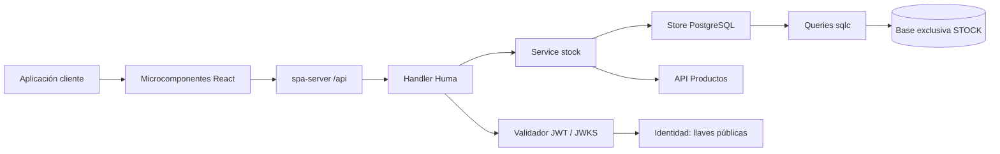

# Arquitectura de STOCK

STOCK es dueño de las cantidades, sus movimientos y su auditoría. Productos conserva
su catálogo e Identidad firma las sesiones. Las dependencias van de STOCK a esos
proveedores mediante HTTP; no hay acceso a sus bases ni importación de código de dominio.

## Responsabilidades por capa

| Capa          | Ubicación                      | Responsabilidad                                        |
| ------------- | ------------------------------ | ------------------------------------------------------ |
| Inicio        | `apps/api/cmd/api`             | Configuración validada, conexiones, señales y servidor |
| HTTP          | `apps/api/internal/api`        | Contrato, validaciones, permisos, HTTP y errores       |
| Negocio       | `apps/api/internal/service`    | Reglas, cálculo de movimientos y coordinación          |
| Persistencia  | `apps/api/internal/store`      | Transacciones, bloqueo y adaptación de datos           |
| SQL generado  | `apps/api/internal/repository` | Queries generadas con sqlc; no editar                  |
| Productos     | `apps/api/internal/productos`  | Cliente tipado, timeout y propagación de credenciales  |
| Autenticación | `apps/api/internal/auth`       | RS256/EdDSA, JWKS, emisor, audiencia y expiración      |

El handler llama al service. El service usa puertos propios y no conoce HTTP ni SQL.
El store aplica la transacción y no decide reglas de autorización. Los datos de Productos
se solicitan por REST, reenviando JWT y `X-Request-Id`, con timeout de cinco segundos.

## Consistencia e idempotencia

Cada producto tiene una fila de `existencias` con cantidad no negativa y versión. Una
mutación serializa el saldo dentro de una transacción. En la misma transacción se
registran el movimiento y la auditoría; el commit confirma todo el cambio.

Las operaciones tienen una clave de idempotencia por actor y una huella de la solicitud.
El reintento idéntico devuelve el movimiento original. Reutilizar la clave con otro
contenido produce 409. Los consumidores deben conservar la clave si desconocen si una
solicitud anterior se confirmó.

Una entrada suma unidades, una salida las resta y un ajuste establece un saldo final.
El ajuste requiere la versión que observó el cliente y evita sobrescribir cambios
recientes. Su movimiento conserva la magnitud de la variación y los saldos anterior y
posterior. Un ajuste sin cambio efectivo se rechaza.

No se modifican ni borran movimientos históricos. Una reversa es un movimiento inverso,
con clave nueva y referencia al original. STOCK no modifica datos de Productos.

## Datos y despliegue

Las migraciones goose crean `existencias`, `movimientos` y `auditoria`, con UUID,
cantidades enteras, constraints e instantes `timestamptz`. Las migraciones ya desplegadas
no se editan. La API no ejecuta migraciones.

Compose levanta PostgreSQL, espera su healthcheck, ejecuta el contenedor de migración y
sólo entonces inicia API y web. API y web escuchan en 8080 dentro del contenedor y usan
distroless sin root. El frontend se comunica por el proxy del mismo origen. El runtime
de migraciones usa Alpine y el ejecutable goose; no contiene el compilador Go.

`/healthz` verifica vida; `/readyz` requiere una respuesta de PostgreSQL. Los logs JSON
de la API permiten correlacionar cada solicitud mediante `X-Request-Id`. No contienen
tokens, cookies ni cuerpos completos. La auditoría conserva actor, acción e instante.

## Microcomponentes

`ConsultaStock`, `MovimientoStock` e `HistorialStock` son unidades autónomas bajo
`apps/web/src/componentes/`. Cada unidad contiene vista, hook y cliente `*.api.ts`.
Sólo esos clientes realizan peticiones. Los componentes comparten tipos y estilos,
reciben URL y permisos por props y no se importan entre sí.

La app Vite sólo permite desarrollar y demostrar esos componentes. MSW se activa con
`?demo=1`; la biblioteca publicada no inicia mocks ni monta la app anfitriona. La versión
del contrato consumida se declara en los metadatos del paquete.
